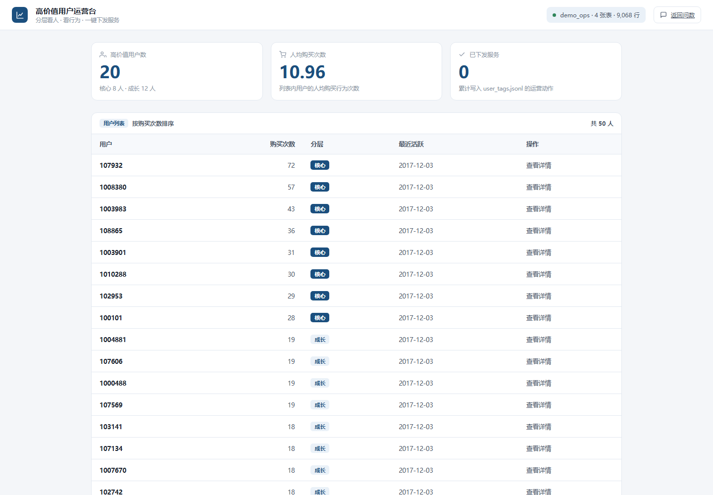
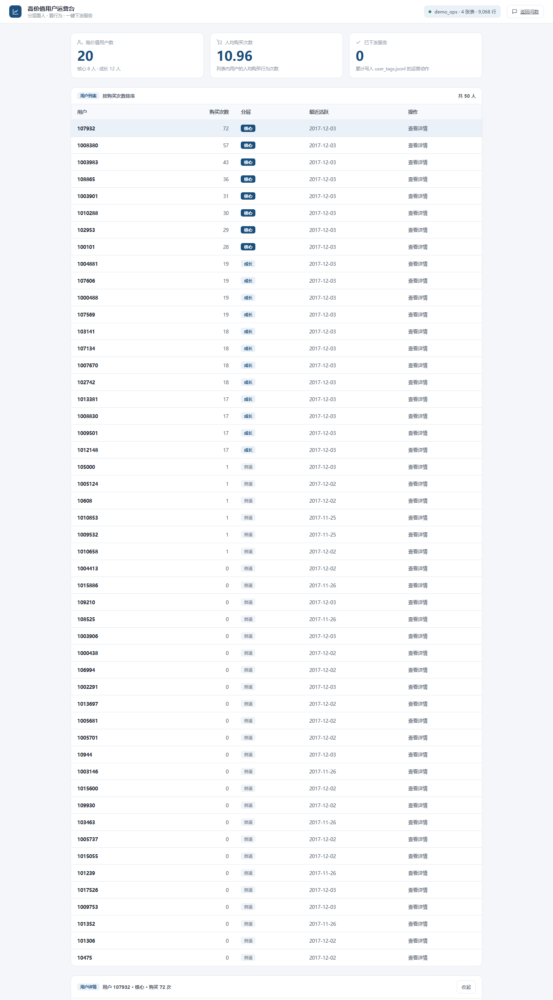
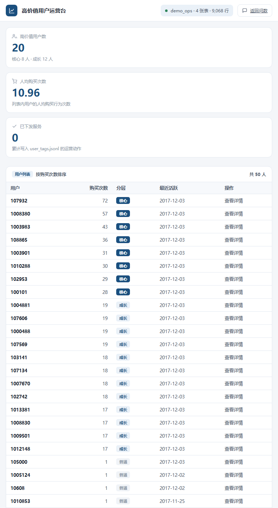
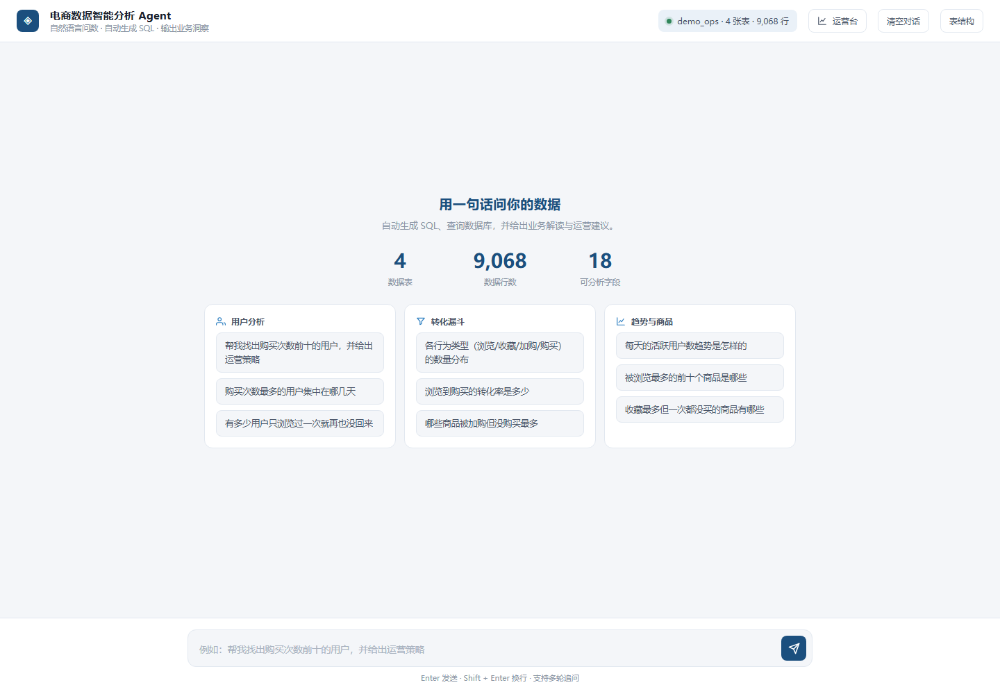
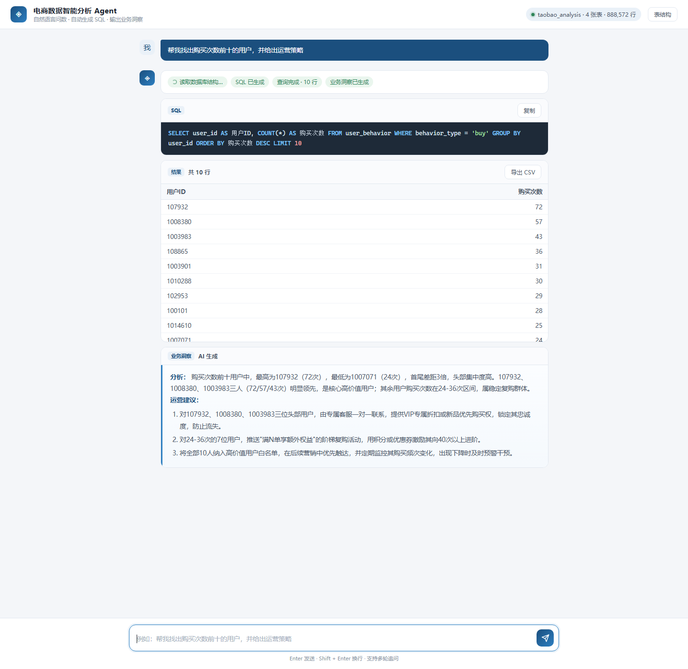
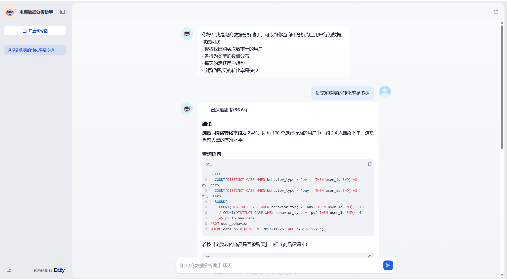

# 电商数据智能分析 Agent · Web 版

### 📌 项目简介
传统取数流程：业务提需求 → 排期 → 开发写 SQL → 等结果，周期长、沟通成本高。

本项目实现了一个 NL2SQL 智能问数 Agent，业务人员只需在网页里输入中文问题，系统自动完成：

1. 读取数据库表结构（自动生成提示词）
2. 调用大模型生成 SQL
3. 执行 SQL 并返回结果表格
4. 基于结果生成业务洞察与运营建议

---

## 效果

提问 → 自动生成 SQL → 执行查询 → 结果表格 + 业务洞察，全程流式展示：

```
你：帮我找出购买次数前十的用户，并给出运营策略

Agent：
  ▸ 读取数据库结构…          ✓
  ▸ 生成 SQL…                ✓
  SELECT user_id AS 用户ID, COUNT(*) AS 购买次数
  FROM user_behavior WHERE behavior_type = 'buy'
  GROUP BY user_id ORDER BY 购买次数 DESC LIMIT 10
  ▸ 查询完成 · 10 行         ✓
  ┌─────────┬──────────┐
  │ 用户ID  │ 购买次数 │
  ├─────────┼──────────┤
  │ 107932  │       72 │
  │ 1008380 │       57 │
  └─────────┴──────────┘
  ▸ 业务洞察已生成           ✓

  **分析：** 头部用户购买频次远高于普通用户，是平台高价值核心客群…
  **运营建议：**
  1. 对购买 40 次以上的三位用户建立 VIP 专属档案…
  2. 对 24–36 次区间的用户推送会员等级升级提醒…
```

---

## 相比命令行版多了什么

| 能力 | 说明 |
|---|---|
| **浏览器交互** | 对话式界面，支持多轮追问（"那加购和购买的比例是多少"） |
| **表结构自动读取** | 从 `information_schema` 自动生成提示词，加了新表不用再手改 `TABLE_SCHEMA`；顺带把 `users` / `products` / `categories` 也纳入了 |
| **列值采样** | 对低基数列（distinct ≤ 20 的字符串列）采样真实取值写进提示词，例如 `behavior_type（取值样例: buy / cart / fav / pv）` —— 模型不用猜"是 pv 还是 view"，比反复强调"不要臆造"有效 |
| **SQL 只读护栏** | 只放行 `SELECT` / `WITH`，拦截 `DROP` / `DELETE` / `UPDATE` / `INSERT` / 多语句注入；`LIMIT` 强制收敛到上限内（写 `LIMIT 999999` 也绕不过去） |
| **SQL 自愈重试** | 执行报错时把 MySQL 的错误信息回传给模型，让它自己改，最多重试 2 次 |
| **超纲拒答** | 问题需要的字段表里根本没有（手机号 / 金额 / 地址）时，模型返回拒答标记，前端友好提示，**不硬编一条假 SQL** |
| **多轮上下文** | 除了上一轮的问题和 SQL，还把上一轮结果的"列名 + 行数 + 前几行"带进下一轮，追问"再按类目拆一下"不会答非所问 |
| **流式输出** | SSE 推送，SQL、结果表、洞察逐步出现，不用干等 |
| **结果可导出** | 表格右上角一键导出 CSV（带 BOM，Excel 打开不乱码） |
| **👍/👎 反馈** | 结果卡片上点一下即落盘 `feedback.jsonl`，积累真实 bad case |
| **多工具 Agent（可切换）** | 问数页顶栏可切「流水线 / Agent」两种模式。Agent 模式下**模型自己决定调哪个工具、调几步**：`query_schema`（看表结构）、`query_column_values`（看字段取值）、`run_sql`（跑查询）、`search_docs`（检索运营口径文档），页面上能实时看到每一步在干什么 |
| **运营台（闭环）** | `/console` 把分析结果落到人身上：按购买行为分层 → 看用户画像与推荐商品 → 一键下发服务并落盘 `user_tags.jsonl`，形成「分析 → 决策 → 行动」闭环 |
| **可量化评估** | `eval/` 下一套 25 条用例 + 一键跑分脚本，输出执行成功率 / 语义正确率 / token 成本 |
| **可观测** | 每次提问的问题、SQL、重试次数、耗时、行数、token 全量落 `logs/app.log` |
| **废弃列屏蔽** | `user_behavior.behavior_count` 全为 0，已从提示词里剔除，避免模型误用得出错误结论 |
| **密钥外置 / 错误脱敏** | 密钥走 `.env`；原始报错只进日志，前端只看到友好提示 |

> 历史上的命令行版本 `ai_sql_agent.py` 已移除：它的能力已全部由 `app.py` 覆盖，
> 且脚本里存在硬编码的数据库密码（**该密码已泄露，请务必更换**）。

---

## 🛠️ 技术栈

**后端（主力）**
- FastAPI + Uvicorn：REST 接口 + SSE 流式返回（模型边算边把结果推给页面）
- PyMySQL：连接 MySQL、参数化查询、游标取列名

**数据层**
- MySQL 8.0：建表（事实表 + 3 张维表）、加普通索引、从 information_schema 自动读表结构
- SQL：多表关联、子查询、GROUP BY 分组统计、CASE WHEN 分段、时间区间过滤

**AI 应用**
- DeepSeek API（兼容 OpenAI SDK）：生成 SQL + 生成业务洞察
- Prompt 设计：表结构与字段注释、Few-shot 示例、列值采样、多轮上下文
- 护栏与成本：只读校验、报错自愈重试（≤2 次）、token 用量统计
- Agent：Function Calling + 多工具编排（4 个工具、最多 3 步），前端展示执行过程
- 评测：26 条固定用例 + 一键跑分脚本（成功率 / 拒答率 / 延迟 / token / 工具选择）

**前端**
- 原生 JavaScript 单文件（无框架、无构建）：页面由 AI 编程助手生成，
  我负责需求拆解、接口联调与调试验证；能读懂现有代码并做小幅修改

**工程与质量**
- pytest：30 条用例回归 SQL 护栏与错误脱敏
- logging：运行日志（问题 / SQL / 重试次数 / 耗时 / 行数 / token）
- Git + GitHub：版本管理

**环境**
- Windows + PowerShell、VS Code、pip 依赖管理、.env 配置外置
---

## 快速开始

```bash
# 1. 安装依赖
pip install -r requirements.txt

# 2. 配置密钥（复制模板后填入自己的值）
copy .env.example .env      # Windows
# cp .env.example .env      # macOS / Linux
# 然后编辑 .env，至少填 DEEPSEEK_API_KEY / DB_USER / DB_PASSWORD

# 3. 建表并导入样例数据（详见下方「数据导入」）
mysql -u root -p < sql/00_init.sql

# 4. 启动
python app.py
```

然后打开 **http://127.0.0.1:8000**

> 也可以用 `python -m uvicorn app:app --host 127.0.0.1 --port 8000 --reload` 启动，带热重载。
> 端口由 `.env` 里的 `PORT` 控制（默认 8000），前端 `index.html` 的回连地址同样是 8000，
> 改端口时两处要一起改。

### `.env` 说明

| 变量 | 默认值 | 说明 |
|---|---|---|
| `DEEPSEEK_API_KEY` | 无（必填） | DeepSeek 密钥，未配置时页面会直接提示 |
| `DEEPSEEK_BASE_URL` | `https://api.deepseek.com/v1` | 兼容 OpenAI SDK 的接口地址 |
| `DEEPSEEK_MODEL` | `deepseek-chat` | 模型名 |
| `DB_HOST` | `localhost` | MySQL 地址 |
| `DB_PORT` | `3306` | MySQL 端口 |
| `DB_USER` | `root` | 数据库账号 |
| `DB_PASSWORD` | 空 | 数据库密码 |
| `DB_NAME` | `taobao_analysis` | 库名，与 `sql/00_init.sql` 一致 |
| `HIDDEN_COLUMNS` | `user_behavior.behavior_count` | 不暴露给模型的列，格式 `表名.列名`，逗号分隔 |
| `MAX_ROWS_RETURN` | `200` | 回传前端的最大行数（表格 + CSV） |
| `SQL_HARD_LIMIT` | `1000` | SQL 护栏强制的最大返回行数 |
| `MAX_SQL_RETRY` | `2` | SQL 执行失败后的自愈重试次数 |
| `PORT` | `8000` | 服务端口 |

**`.env` 已在 `.gitignore` 中，不会被提交。**

---

## 目录结构

```
实习项目2/
├── app.py                        # FastAPI 后端：三步链路 + SQL 护栏 + SSE + 运营台接口
├── agent.py                      # Agent 编排：模型自己决定调哪个工具、调几步
├── tools.py                      # Agent 工具层：查表结构 / 查字段取值 / 跑 SQL / 检索口径文档
├── static/
│   ├── index.html                # 问数页（单文件原生 JS，无构建步骤；顶栏可切流水线/Agent）
│   └── console.html              # 高价值用户运营台（单文件原生 JS）
├── sql/
│   ├── 00_init.sql               # 建库建表 + 样例数据（第一次跑必执行）
│   ├── 01_behavior_analysis.sql  # 手工分析 SQL 参考（行为漏斗 / 高频购买用户）
│   └── 02_funnel_by_user.sql     # 按用户去重的严格顺序漏斗（含口径说明与结果）
├── docs/
│   ├── CHANGELOG.md              # 改动总览（写简历 / 面试用）
│   └── 口径文档.md               # 给 Agent 检索的运营口径说明（示例文档）
├── eval/
│   ├── cases.json                # 25 条评估用例（含 3 条超纲拒答用例）
│   ├── cases_aug.json            # 26 条版本：问题里显式写明数据时间范围
│   ├── run_eval.py               # 一键跑分：流水线 / Agent 两种模式
│   ├── results.md                # 最近一次流水线跑分结果
│   └── eval_agent5.md            # Agent 模式首批 5 条跑分结果
├── tests/
│   ├── test_guard.py             # SQL 护栏 + 错误脱敏的回归测试（pytest）
│   ├── test_tools.py             # 工具层测试（16 条）
│   └── test_agent.py             # 知识库检索 + 兜底逻辑测试（13 条）
├── images/                       # README 用效果图
├── logs/
│   └── app.log                   # 运行日志（自动创建，已 gitignore）
├── feedback.jsonl                # 👍/👎 反馈（运行后生成，已 gitignore）
├── user_tags.jsonl               # 运营动作记录（运行后生成，已 gitignore）
├── requirements.txt
├── .env.example                  # 环境变量模板
└── README.md
```

跑一遍测试（可选，只依赖 pytest）：

```bash
python -m pytest tests -q
```

---

## 数据导入

**数据来源：** `sql/00_init.sql` 里是 **425 行样例数据**，从真实公开数据集
[AliMobile / UserBehavior](https://tianchi.aliyun.com/dataset/649)（淘宝用户行为，约 1 亿行）
按「4 个自然日 + 购买频次最高的两位用户」抽样而来，覆盖 `pv` / `fav` / `cart` / `buy` 四类行为。
它只够演示与自测，**不建议直接拿来做真实分析结论**。

想跑真实规模（本项目本地验证用的是约 60 万行版本）：

1. 从上面的数据集下载 `UserBehavior.csv`；
2. 建表导入（`date_only` 需要自己回填，否则按天聚合的问题查不到数据）：

   ```sql
   LOAD DATA LOCAL INFILE 'UserBehavior.csv' INTO TABLE user_behavior
   FIELDS TERMINATED BY ',' LINES TERMINATED BY '\n'
   (user_id, item_id, category_id, behavior_type, @ts, behavior_count)
   SET `timestamp` = @ts,
       `date`      = FROM_UNIXTIME(@ts),
       date_only   = DATE(FROM_UNIXTIME(@ts));
   ```

3. `users` / `products` / `categories` 三张维表按需从 `user_behavior` 去重生成：

   ```sql
   INSERT IGNORE INTO users (user_id)      SELECT DISTINCT user_id FROM user_behavior;
   INSERT IGNORE INTO products (item_id)   SELECT DISTINCT item_id FROM user_behavior;
   INSERT IGNORE INTO categories (category_id) SELECT DISTINCT category_id FROM user_behavior;
   ```

**导入方法：**

```bash
# 方式一：命令行
mysql -u root -p < sql/00_init.sql

# 方式二：进入 MySQL 客户端后执行
mysql -u root -p
source sql/00_init.sql;
```

脚本可重复执行（开头会 `DROP TABLE` 重建），执行完会打印一次行为分布自检结果。

> ⚠️ 脚本开头是 `DROP TABLE` —— 如果你的库里已经有真实数据，**不要**直接执行它。

**表结构：**

| 表 | 说明 | 关键字段 |
|---|---|---|
| `user_behavior` | 用户行为明细事实表（核心表） | `id`（自增主键）、`user_id`、`item_id`、`category_id`、`behavior_type`（pv/fav/cart/buy）、`timestamp`、`date`、`date_only`（按天聚合用这列）、`behavior_count`（废弃列，全为 0） |
| `users` | 用户维表 | `user_id`、`member_level`（普通/银卡/金卡/钻石）、`city`、`register_at` |
| `products` | 商品维表 | `item_id`、`item_name`、`category_id`、`price` |
| `categories` | 类目维表 | `category_id`、`name`（女装/数码/家居/美妆/食品/运动/母婴/图书） |

> 维表里只有 ID 是真实的：`member_level` / `city` / `register_at` / `item_name` / `price` / 类目名
> 都是按业务常识生成的**演示属性**（由稳定哈希生成，重复执行结果一致），
> 用来支撑分层、客单价、商品推荐这类必须有维表字段才能做的分析。

> 表结构由 `information_schema` 自动读取，**新增表不用改代码**，刷新页面即可被模型看到。
> 唯一需要注意的是"脏列"：像 `behavior_count` 这种全为 0 的列会误导模型，
> 把它加进 `HIDDEN_COLUMNS` 就会从提示词里剔除。

---

## 接口

| 方法 | 路径 | 说明 |
|---|---|---|
| GET | `/` | 问数页（对话式问数 + SQL + 结果表 + 业务洞察） |
| GET | `/console` | 高价值用户运营台（分层看人 → 看推荐 → 下发服务） |
| GET | `/api/health` | 探活：数据库连通性、表数量、总行数、Key 是否配置 |
| GET | `/api/schema` | 返回 Agent 实际看到的表结构文本（含列值采样） |
| POST | `/api/ask` | 提问，SSE 流式返回 `stage` / `sql` / `result` / `insight` / `refusal` / `error` / `done` |
| POST | `/api/feedback` | 提交 👍/👎（`rating`: `up`/`down`），追加写入 `feedback.jsonl` |
| GET | `/api/high-value-users?limit=50` | 高价值用户列表：一条 SQL 聚合出 `buy_count / view_count / cart_count / category_count / last_active / tier` |
| POST | `/api/tag-user` | 下发服务，`{user_id, tier, action}` 追加写入 `user_tags.jsonl` |
| GET | `/api/recommend?user_id=xxx` | 推荐商品（最多 5 个，加购未买优先、同偏好类目热销补齐）+ 一句推荐理由 |
| POST | `/api/agent` | **Agent 模式**：多工具 + 多步，SSE 流式返回 `stage` / `tool`（每步一句）/ `answer` / `done` |

### 高价值用户分层口径

写死在 `app.py` 的 `TIER_CORE_MIN` / `TIER_GROW_MIN`，改口径就改常量：

| 分层 | 规则 | 运营含义 |
|---|---|---|
| 核心 | `buy_count ≥ 20` | 高频复购，优先给专属权益与新品试用 |
| 成长 | `buy_count ≥ 5` | 已形成复购习惯，重点是提频与提客单 |
| 普通 | `buy_count < 5` | 以拉新后的首购转化为主 |


---

## 效果评估

**为什么要做：** "这个 Agent 好不好用"不能靠演示时挑一个能跑通的问题来证明。
需要一套固定用例 + 可复现的跑分，才能回答"改了提示词之后是变好了还是变差了"。

**怎么测：**

```bash
python eval/run_eval.py --cases eval/cases_aug.json --resume --out eval/eval_aug.md   # 全量 26 条
python eval/run_eval.py --limit 5       # 先跑 5 条，省 API 成本
python eval/run_eval.py --no-insight    # 只测取数链路，不生成洞察（最省 token）
```

> `--resume` 表示失败先记一次、不自动重试，这样统计出的重试次数才代表真实成本；
> 用例集 `eval/cases_aug.json` 是在原 25 条基础上加了 1 条时间区间题，并在问题里显式写明数据时间范围。

**用例设计**（26 条）：

| 类型 | 条数 | 例子 |
|---|---|---|
| 单表聚合 / 排序 | 9 | 购买次数最多的前十个用户 |
| 漏斗与转化 | 5 | 浏览到购买的转化率是多少 |
| 时间维度 | 5 | 每天的活跃用户数趋势 |
| 需要子查询 / CASE | 4 | 购买频次分布：买 1 次、2-5 次、5 次以上各几人 |
| **超纲拒答** | 3 | 这些用户的手机号分别是多少 |

**判分口径**（刻意保持朴素）：执行成功 = 过护栏且 MySQL 不报错；结果符合预期 = 用例里的
`must_have` 关键词全部出现在生成的 SQL 里，或超纲题走了拒答通道。**故意不做逐字比对** ——
模型对同一口径的别名、大小写、排序列每次都不一样，逐字比对会把正确的 SQL 判成错的。
这套指标衡量的是"用对了表和过滤条件"，不是"字符完全一致"。

**最近一次结果**（全量 26 条，运行于 2026-10-10 17:30，示例数据集）：

| 指标 | 结果 |
|---|---|
| SQL 执行成功率（过护栏且不报错） | 23/23 = **100%** |
| 结果符合预期（含 3 条正确拒答） | 24/26 = **92.3%** |
| 超纲问题正确拒答率 | 3/3 = **100%** |
| 平均端到端耗时（含生成 SQL + 生成洞察两次调用） | **2.65s** |
| 平均 token 消耗 | 33,810 / 26 = **约 1,300 token/问** |
| 触发自愈重试 | 0 次 |

**两处未命中用例（都已定位原因，不是报错）：**

| 用例 | 问题 | 模型的写法 | 原因 |
|---|---|---|---|
| Q16 | 每个商品从浏览到购买要经过几次行为 | `GROUP BY item_id` 后没加 `HAVING` | 提示词缺少"分组后筛选"的示例，空分组也进了结果 → 下一步补 Few-shot |
| Q17 | 最近一天的活跃用户数是多少 | `GROUP BY date_only ORDER BY 日期 DESC LIMIT 1` | 用排序取第一条表达"最近一天"，结果正确但判分口径过严 → 已放宽关键词 |

> 完整逐条结果见 [`eval/results.md`](eval/results.md)，原始数据（含每条生成的 SQL、耗时、token）
> 见 `eval/eval_aug.json`。**这些数字都是真实跑出来的，不是估计值。**

**已知边界**：示例数据集只有 4,784 行、跨 10 天，趋势类问题（如"每天的活跃用户数"）区分度有限；
指标对提示词改动敏感，所以每次改提示词都应重跑，别拿旧结果当新结论。

---

## 流水线 vs Agent：同一套用例的两种架构

这是本项目里最能说明"设计取舍"的一组数据 —— **同一批用例，两种跑法，指标完全不同**：

```bash
python eval/run_eval.py --cases eval/cases_aug.json --resume --out eval/eval_aug.md          # 流水线
python eval/run_eval.py --mode agent --cases eval/cases_aug.json --out eval/eval_agent.md    # Agent
```

| 指标 | 流水线（固定链路） | Agent（多工具多步） |
|---|---|---|
| 执行成功率 | 100%（23/23） | 100%（5/5，首批） |
| 平均耗时 | **2.65s** | 4.08s |
| 平均 token | **约 1,300 / 问** | 约 3,989 / 问 |
| 平均工具调用步数 | — （流程写死，固定 4 步） | 2.8 步（模型自己决定） |
| 工具选择正确率 | — | 100%（5/5） |
| 能回答的问题类型 | 只要取数类 | 取数 + 指标口径类（会先查口径文档） |
| 走几步谁决定 | 代码 | **模型** |

**怎么选**：只问数据、追求快和便宜 → 流水线；要问"复购率怎么算"这类口径问题、或者希望它自己决定先看表结构 → Agent。

> **Agent 版已知问题**：`max_steps=3` 时，有的问题会被"看表结构 + 看字段取值 + 跑一次 SQL"占满 3 步，
> 没机会写最终 SQL（例如 Q01 首次跑就是这样）。解决办法是把 `max_steps` 提到 4–5，或者少给一个探索工具。
> 这个坑写在 README 里，是因为**"知道自己的方案在哪会翻车"比"指标好看"更重要**。

---

## 安全

- **只读护栏**：`guard_sql()` 做三件事 ——
  ① 白名单：只放行 `SELECT` / `WITH` / `SHOW` / `DESC` / `EXPLAIN`；
  ② 黑名单：拦截 `INSERT` / `UPDATE` / `DELETE` / `DROP` / `ALTER` / `GRANT` / `INTO OUTFILE` 等写操作与多语句注入；
  ③ **强制行数上限**：`LIMIT` 会被压到 `SQL_HARD_LIMIT`（默认 1000）以内，没写 `LIMIT` 就补一个 ——
  也就是说模型写 `LIMIT 999999` 这类"假上限"也绕不过去，`LIMIT n, m` / `LIMIT n OFFSET m` 同样处理。

  **但它不是最终防线**：正则看不懂 MySQL 完整语法，模型用方言特性（注释、函数、动态 SQL）仍可能绕过静态检查。
  真正的兜底应该是数据库权限本身 —— 生产环境请再配一个只读账号，只授予 `SELECT`：

  ```sql
  CREATE USER 'nl2sql_ro'@'%' IDENTIFIED BY '换成强密码';
  GRANT SELECT ON taobao_analysis.* TO 'nl2sql_ro'@'%';
  FLUSH PRIVILEGES;
  ```

  然后把 `.env` 里的 `DB_USER` / `DB_PASSWORD` 换成这个账号。
- **密钥不入库**：`.env` 走 `.gitignore`；提交前用 `git status` 确认它没被跟踪。
  一旦密钥进过仓库历史（哪怕是私有仓库），都应视为已泄露 → 到控制台吊销并重发。
- **删文件 ≠ 删历史**：这个项目早期的命令行版 `ai_sql_agent.py` 把数据库密码写死在代码里，
  文件虽然删了，但密码仍留在历史提交里：

  ```bash
  git grep -n '<旧密码>' $(git rev-list --all)   # 能查到，说明还在历史里
  ```

  处理顺序（密码类泄露，**改密码永远优先于清历史**）：

  ```bash
  # 1) 先改掉数据库密码（最有效，历史里那个密码随即作废）
  #    MySQL 8：ALTER USER 'root'@'localhost' IDENTIFIED BY '新密码';  再同步 .env

  # 2) 再决定要不要清历史（需要 git-filter-repo：pip install git-filter-repo）
  git filter-repo --path ai_sql_agent.py --path static/ai_sql_agent.py --invert-paths

  # 3) 清完强推，并让所有协作者重新克隆（旧提交仍在各自本地，必须重克隆）
  git push --force --all
  ```

  同理，API Key 一旦出现在聊天记录、截图、日志里，也应当作已泄露处理 —— 吊销重发。
- **错误脱敏**：数据库原始报错只写 `logs/app.log`（含表名、库名、连接信息），
  前端和回传给模型的都只有可公开的信息 —— 前端显示"查询失败，详情见日志"，
  模型只拿到 MySQL 错误码 + 报错消息（够它改 SQL 就行）。
- **不要直接暴露到公网**：服务默认只监听 `127.0.0.1`，没有鉴权与限流，属于内网工具定位。

---

## 产品思考

**痛点是什么。** 业务想看一个数，标准流程是提需求 → 排期 → 开发写 SQL → 等结果，
一来一回 1-3 天，而其中大部分问题都是"同几张表的固定几种口径"（Top N、按天趋势、转化率、
加购未购买）。真正被消耗掉的不是 SQL 本身，而是**沟通成本**：业务说不清口径，开发猜着写，
结果不是他们要的，再返工一轮。这个项目的目标不是"替代分析师"，而是把这类**"我要的其实是个标准口径"**
的问题压缩到 5 秒内拿到结果，同时把 SQL 和口径**显式展示出来**——业务能看到"系统是怎么理解我的问题的"，
这比给一个黑盒数字更有价值。

**效果怎么衡量（不靠演示，靠指标）。** 见「效果评估」一节，这里只讲指标选择：
- **执行成功率**：链路通不通（护栏误拦、SQL 语法错、字段不存在都会掉在这里）；
- **语义正确率**：口径对不对（用 `must_have` 关键词校验表、过滤条件、聚合维度是否用对）；
- **超纲拒答率**：知不知道自己的能力边界（该拒答时硬编 SQL，比报错危险得多）；
- **每问 token 成本**：这个方案能不能规模化（当前均值 ≈ 1,360 token/问）。

这四个指标里，**语义正确率是唯一不能靠工程手段刷高的**，它直接反映提示词质量，所以每次改提示词都应该重跑。

**成本边界在哪。**
- **单次成本**：一次提问 ≈ 1,360 token，SQL 生成 1 次 + 洞察 1 次；报错自愈最多 3 次调用，
  所以单问成本有上限（`MAX_SQL_RETRY` 就是成本闸门）。
- **查询成本**：把"数据量多少行"写进提示词、强制 `LIMIT`、引导模型先聚合再取明细，
  都是为了避免一条 SQL 把线上库拖死；`SQL_HARD_LIMIT` 是硬闸门。
- **拒答也是一省钱的机制**：超纲问题在第 1 次调用就结束，不会"硬编 SQL → 执行失败 → 重试 → 再生成洞察"白烧 4 次调用。
- **明确的边界**：这套方案适合**中小数据量 + 读多写少 + 口径相对稳定**的场景。
  数据量上到亿级、或需要跨库 join 时，瓶颈会从"模型写 SQL"转移到"SQL 执行效率"，
  那时该做的是物化视图 / 预聚合层，而不是继续调提示词。

**接下来会往哪迭代。**
1. **业务术语词典**：现在靠列注释和列值采样（`behavior_type → pv/fav/cart/buy`）传递语义，
   但"复购率""高价值用户"这类**公司内部口径**模型仍然不知道，需要一层可配置的术语映射（轻量 RAG 的雏形）。
2. **口径确认而非直接执行**：破坏性/昂贵查询先反问"我理解你要的是 X，对吗"，把错误挡在执行之前。
3. **答案可信度标注**：把"生成了几条候选 SQL、结果是否为空、是否命中列值采样"等信息变成用户可见的置信提示。
4. **反馈回流**：`feedback.jsonl` 里的 👎 目前只是被记录下来，下一步应自动聚类成 bad case 并补进 `eval/cases.json`，
   让评测集随真实使用一起长大 —— 这是把"能跑"变成"越用越准"的关键一步。
5. **只读账号 + 限流**：从"演示工具"走向"内部可用系统"的前提。

---

## 网页效果展示图

### 高价值用户运营台（`/console`）

分层看人 → 看推荐商品与理由 → 一键下发服务（落盘 `user_tags.jsonl`）：




窄屏（768px）下多列自动塌成单列：



### 问数页（`/`）

空状态带真实数据概览与三组主题示例；提问后流式给出 SQL、结果表与业务洞察：





---


